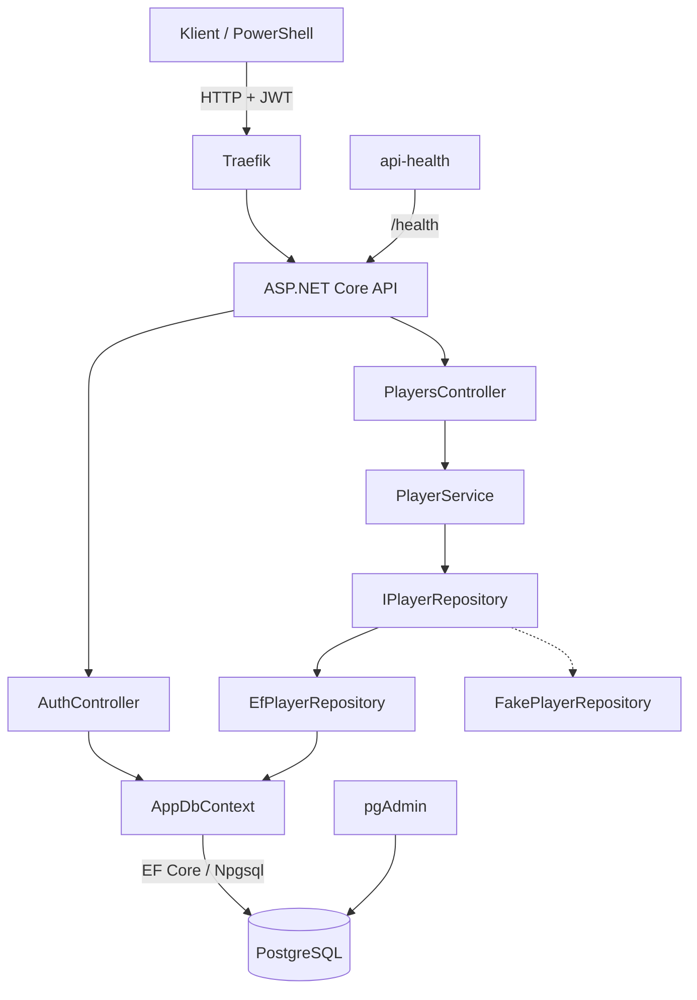

# Arkitektur – XP Level System

## Oversikt

XP Level System er et REST API utviklet med C# og ASP.NET Core 10. Systemet lar brukere registrere seg, logge inn og administrere sine egne spillere. Spillere kan få erfaring (XP) og øke i level.

Prosjektet er delt i et API-prosjekt og et Core-prosjekt. API-et håndterer HTTP-forespørsler, autentisering og datatilgang, mens Core inneholder domenemodellen og forretningslogikken.

## Arkitekturdiagram

Den stiplede linjen viser FakePlayerRepository, som kan brukes i utvikling og testing i stedet for PostgreSQL.

## Hvor kjører komponentene?

Ved kjøring med Docker Compose brukes følgende containere:

- **API:** ASP.NET Core-applikasjonen med controllers, services og datatilgang.
- **Traefik:** Reverse proxy som videresender forespørsler til API-et.
- **PostgreSQL:** Database for brukere og spillere.
- **pgAdmin:** Administrasjonsgrensesnitt for PostgreSQL.
- **api-health:** Kontrollerer at API-et svarer på health-endepunktet.

Core-prosjektet er ikke en egen tjeneste eller container. Det brukes som et klassebibliotek av API-et.

## Kommunikasjon

Klienten sender HTTP-forespørsler gjennom Traefik til API-et.

Ved registrering og innlogging håndterer AuthController forespørselen. Den bruker AppDbContext til å lese og lagre brukere. Passord hashes med BCrypt.

Ved spilleroperasjoner mottar PlayersController forespørselen og kaller PlayerService. Tjenesten bruker IPlayerRepository, som har to implementasjoner: EfPlayerRepository og FakePlayerRepository.

EfPlayerRepository bruker Entity Framework Core til å kommunisere med PostgreSQL.

## Datalagring

PostgreSQL lagrer brukere og spillere permanent i et Docker-volum.

AppDbContext inneholder DbSet for User og Player. EF Core-migrasjoner brukes til å opprette og oppdatere databaseskjemaet.

FakePlayerRepository lagrer data i minnet og brukes når databasen ikke er konfigurert i utviklingsmiljøet og i tester.

## Brukeridentifikasjon og sikkerhet

Brukeren registrerer seg med brukernavn og passord. Passordet hashes med BCrypt før det lagres.

Ved innlogging mottar brukeren et signert JWT-token. Tokenet inneholder brukerens ID.

Spillerendepunktene krever et gyldig JWT-token. PlayersController leser bruker-ID fra tokenet og sender den videre til PlayerService og repository-laget.

Repository-laget filtrerer spilleroperasjoner etter UserId. Dette hindrer at en bruker kan hente, endre eller slette spillere som tilhører andre brukere.

## Avhengigheter

- API-prosjektet er avhengig av Core-prosjektet.
- PlayersController er avhengig av PlayerService.
- PlayerService er avhengig av IPlayerRepository.
- EfPlayerRepository er avhengig av AppDbContext og EF Core.
- AppDbContext kommuniserer med PostgreSQL.
- AuthController bruker AppDbContext direkte.
- Docker Compose håndterer oppstart og nettverk mellom containerne.

Denne arkitekturen skiller deler av forretningslogikken fra datatilgangen. Samtidig finnes det områder som kan forbedres, spesielt ulik oppførsel mellom repository-implementasjonene og ansvarsfordelingen i autentiseringen.
