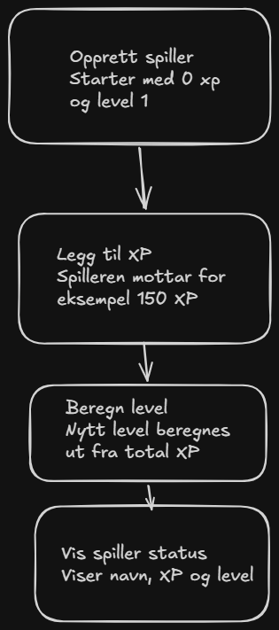

# XP Level System

## MVP – Beskrivelse

Formålet med prosjektet er å lage et XP- og levelsystem som kan brukes for en spiller eller figur i et spill.

Spilleren starter på level 1 med 0 XP. Hver gang spilleren får XP, beregner systemet hvilket level spilleren skal ha. For hver 100 XP spilleren samler totalt, øker level med 1.

Eksempel:
- 0 XP = Level 1
- 100 XP = Level 2
- 200 XP = Level 3
- 350 XP = Level 4

## Objekter

Systemet inneholder en `Player`-klasse med tre egenskaper:

- **Name:** Navnet på spilleren.
- **Experience:** Spillerens totale XP.
- **Level:** Spillerens nåværende nivå, beregnet ut fra XP.

## Regler for XP og Level

- En ny spiller starter med 0 XP og level 1.
- Spilleren øker ett level for hver 100 XP totalt.
- Spilleren kan øke flere levels samtidig.
- XP kan aldri reduseres.
- Forsøk på å legge til negativ XP skal avvises.
- Level beregnes automatisk ut fra spillerens totale XP.
- Bare positive XP-verdier er gyldige. Verdier på 0 eller lavere skal avvises med en feilmelding.
- XP og level skal ikke kunne endres direkte utenfra `Player`-klassen. Endringer i XP skal gå gjennom metoden `AddExperience()`.

## MVP-flytdiagram

Flyten for MVP-en er tegnet i Excalidraw:



Flyten viser hvordan en spiller opprettes, får XP, får beregnet level og kan hente sin oppdaterte spillerstatus.

## Teknologi

- C# og .NET 10
- ASP.NET Core Web API
- xUnit for automatiserte tester
- Git og GitHub for versjonskontroll

Spillere lagres midlertidig i minnet. Det brukes ingen database i denne MVP-en.

## Testdrevet utvikling (TDD)

Prosjektet er utviklet ved hjelp av TDD med tre hovedfaser:

1. **RED:** Skriv en test som feiler fordi funksjonaliteten ennå ikke er implementert.
2. **GREEN:** Implementer nødvendig funksjonalitet slik at testen består.
3. **REFACTOR:** Forbedre koden uten å endre hvordan den fungerer, og kjør testene på nytt.

Git-historikken inneholder separate commits for RED og GREEN, samt refaktorering av domenelogikken.

## Kjøre prosjektet

Fra prosjektets rotmappe:

```powershell
dotnet run --project src/XpLevelSystem.Api
```

API-et starter på adressen som vises i terminalen.

Endepunktene og JSON-eksempler er dokumentert i [API-kontrakten](api.md).

## Kjøre automatiserte tester

Fra prosjektets rotmappe:

```powershell
dotnet test
```

Testene dekker både domenelogikken og REST API-et.

## Manuell testing

API-et er også testet manuelt med PowerShell og `Invoke-RestMethod`.

Vi har blant annet kontrollert at:

- Spillere kan opprettes og hentes.
- XP kan tildeles og level beregnes korrekt.
- Ugyldig XP returnerer `400 Bad Request`.
- Ugyldige XP-forespørsler ikke endrer spillerens status.
- Forespørsler om spillere som ikke finnes, returnerer `404 Not Found`.